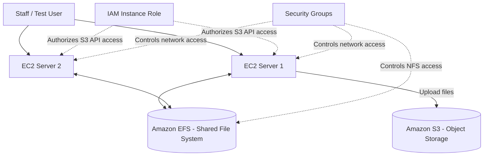

# AWS Shared File System and Object Storage Project

## Project Overview

This project demonstrates how Amazon EFS and Amazon S3 can address different storage requirements in a document-management workload.

 

## Problem statement

An organization needs a shared file system for application servers and scalable object storage for uploaded documents, archives, and backups. Using the same storage approach for every workload may not provide the right access model or operational flexibility.

 

## Proposed Solution

- Amazon EFS provides shared file access across Linux EC2 instances.
- Amazon S3 stores documents as objects and supports lifecycle-based storage management.
- IAM and security groups restrict access to authorized users and services.
- An optional archival workflow copies selected EFS files to S3.

 

## 3. Architecture Diagram

 

## AWS Services Used

- Amazon EC2
- Amazon EFS
- Amazon S3
- AWS IAM
- Amazon VPC and security groups

 

## 7. Network Design

- EC2 instances and EFS mount targets are placed in the same VPC.
- EFS security-group inbound access permits NFS TCP port 2049 from the EC2 security group.
- SSH, if enabled, is restricted to a trusted source IP.
- S3 access is provided through an IAM role and the required network connectivity.

 

## 8. Security Design

- S3 Block Public Access remains enabled.
- Encryption at rest is enabled for storage.
- EFS is mounted using TLS.
- IAM follows the principle of least privilege.
- No credentials or sensitive documents are committed to GitHub.

